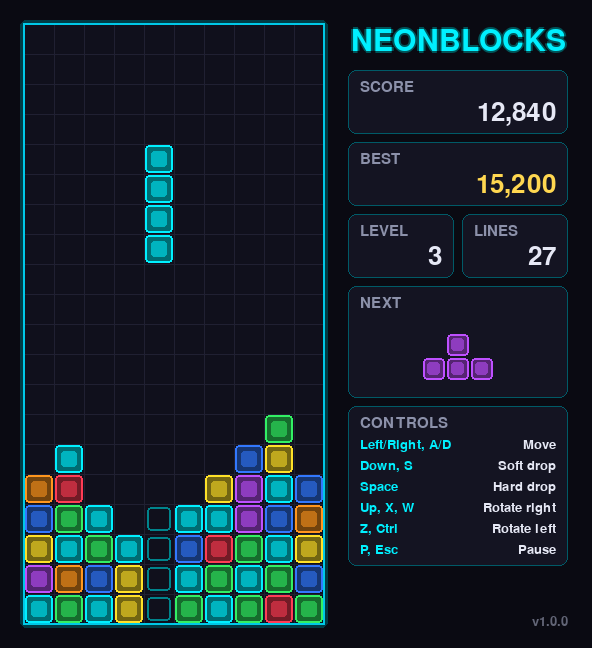

# NeonBlocks

A neon-styled falling-block puzzle game written in Python with [pygame](https://www.pygame.org/).
Stack the pieces, complete horizontal lines to clear them, and survive as the speed increases.



## Features

- 7 classic four-block pieces with fixed colours
- **7-bag randomizer**, so you never wait too long for a piece
- **Ghost piece** that shows where the current piece will land
- Hard drop, soft drop, rotation in both directions with simple **wall kicks**
- **Lock delay**, so you can still slide a piece after it touches down
- Score, level, lines and a **persistent high score**
- Pause (also pauses automatically when the window loses focus), restart, and a game-over screen
- Smooth movement when you hold a key (DAS/ARR-style auto-repeat)
- Retro background music and line-clear sound, with a mute key (see [`assets/`](assets/README.md))
- Game rules kept separate from rendering, with unit tests

## Requirements

- Python 3.8 or newer
- pygame 2.5 or newer

## Installation

```bash
git clone https://github.com/<your-username>/NeonBlocks.git
cd NeonBlocks

# (recommended) create a virtual environment
python -m venv .venv
# Windows:
.venv\Scripts\activate
# macOS / Linux:
source .venv/bin/activate

pip install -r requirements.txt
```

## Running the game

```bash
python main.py
# or
python -m neonblocks
```

## Controls

| Key | Action |
|-----|--------|
| Left / Right, A / D | Move |
| Down, S | Soft drop (+1 point per row) |
| Space | Hard drop (+2 points per row) |
| Up, X, W | Rotate clockwise |
| Z, Ctrl | Rotate counter-clockwise |
| P, Esc | Pause / resume |
| R | Restart (from pause or game over) |
| Q | Quit (from pause or game over) |
| M | Mute / unmute sound |

## Scoring

| Lines cleared at once | Points |
|-----------------------|--------|
| 1 | 100 × level |
| 2 | 300 × level |
| 3 | 500 × level |
| 4 | 800 × level |

The level goes up every 10 lines, and pieces fall faster at each level.

## Where is the high score saved?

The high score is stored in your user data folder, not in the project folder:

| OS | Location |
|----|----------|
| Windows | `%APPDATA%\NeonBlocks\highscore.json` |
| macOS | `~/Library/Application Support/NeonBlocks/highscore.json` |
| Linux | `$XDG_DATA_HOME/NeonBlocks/highscore.json` (default `~/.local/share/...`) |

Delete that file to reset your high score.

## Security notes

- The game makes no network connections and needs no special permissions.
- The high-score file is size-limited and strictly validated when read; a corrupted or edited file is
  ignored instead of crashing the game. Writes are atomic, so the file cannot end up half-written.
- Only JSON is used for saved data. Nothing is executed or unpickled.

## Running the tests

```bash
python -m unittest discover -v
```

The tests cover the game rules (line clears, scoring, levels, rotation, lock delay, game over) and the
high-score storage. They do not open a window.

## Project structure

```
NeonBlocks/
├── main.py              # launcher
├── neonblocks/
│   ├── logic.py         # game rules (no pygame, fully testable)
│   ├── storage.py       # safe high-score persistence
│   └── ui.py            # pygame rendering, input and main loop
├── tests/               # unit tests
├── assets/              # music & sound effects (see CREDITS.md)
├── docs/screenshot.png
└── LICENSE
```

## License

The source code is released under the [MIT License](LICENSE). © 2026 Rizky Maulana Hafis

The audio files in `assets/` are third-party works under the Pixabay Content License and are **not**
covered by the MIT License. See [assets/CREDITS.md](assets/CREDITS.md).
